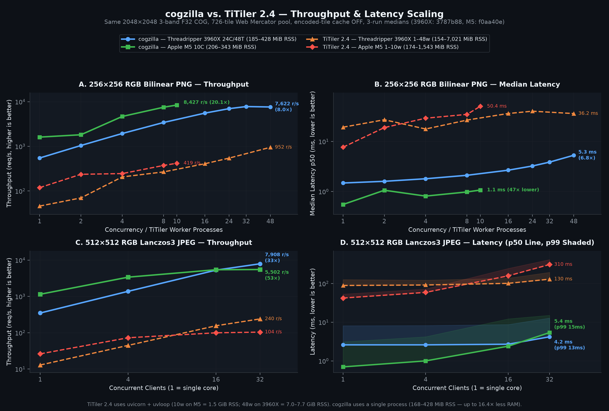

<p align="center">
  
</p>

# `cogzilla`

[](https://github.com/moradology/cogzilla/actions/workflows/ci.yml)
[](https://github.com/moradology/cogzilla/releases/latest)
[](LICENSE)

**A COG, STAC, MosaicJSON & Zarr tile server that speaks TiTiler's API, without GDAL.** Written in Rust. Point your map client at a new base URL and keep everything else.

| Against TiTiler 2.4 (CPU-only, encoded-tile cache off, 3× medians) | `cogzilla` | TiTiler 2.4 | |
| :--- | ---: | ---: | ---: |
| CPU per 1,000 tiles, cold miss (real S3 COGs, Apple M5) | **13.2 CPU-s** | 56.0 CPU-s | **4.3× less** |
| CPU per 1,000 tiles, cached blocks (real S3 COGs, Apple M5) | **1.7 CPU-s** | 55.3 CPU-s | **32× less** |
| Warm `256²` Mercator PNG over HTTP (Apple M5 `10C`, `c=32`) | **15,630 req/s** | 877 req/s | **18×** |
| Warm `256²` RGB PNG over HTTP (3960X `48T` / M5 `10C`) | **7,622 / 8,427** | 952 / 419 | **8–20×** |
| Warm `512²` RGB Lanczos3 JPEG (`c=32`, 3960X `48T` / M5 `10C`) | **7,908 / 5,502** | 240 / 104 | **33–53×** |
| Reprojected UTM RGB / STAC band-math tile (M5, 1 core, warm) | **0.93 / 0.72 ms** | 9.4 / 23.7 ms | **10–33×** |
| GeoJSON polygon statistics / 3-asset STAC point (M5, 1 core, warm) | **12.6 / 0.25 ms** | 54.6 / 15.2 ms | **4.3× / 60×** |
| Memory at idle (M5, 1 process vs 10 TiTiler workers) | **10.9 MiB** | 1,233 MiB | **113× less** |

Plan with the 4.3×: uncached tiles are what an origin behind a CDN mostly serves. The larger multiples need the block cache to hold your working set, and the warm rows are local files with no network. Full tables, hardware specs, and caveats are in [docs/benchmarks.md](docs/benchmarks.md) and [docs/gpu-benchmarks.md](docs/gpu-benchmarks.md).

<p align="center">
  
</p>

<details>
<summary><strong>GPU Acceleration (wgpu Metal &amp; Vulkan) &amp; Live HTTP AIMD Overload Protection</strong></summary>
<p align="center">
  
</p>
</details>

<details>
<summary><strong>Cloud Storage Caching — Real S3 COGs &amp; Verified GDAL Range-Request Behavior</strong></summary>
<p align="center">
  
</p>
</details>

<p align="center">
  
</p>

Mt. Rainier from the public Copernicus 30 m DEM on S3, six ways from one file: colormapped elevation, hillshade, slope, aspect, and the Terrarium and Mapbox Terrain-RGB encodings that drive 3D terrain in MapLibre. Nothing is pre-rendered: every tile is resampled, shaded, colormapped and encoded when it is requested, at **6,778 hillshade tiles/s** (`4.05 ms` p50, `23.9 ms` p99 at `c=32`, encoded-tile cache off) on an Apple M5 once source blocks are cached.

## Try the demo

One command, no data to download and no account:

```bash
docker run --rm -p 8080:8080 ghcr.io/moradology/cogzilla:0.8.0
```

Then open <http://localhost:8080>.

<p align="center">
  
</p>

The server's own front page is the demo. It has one-click maps of public data (Mt. Rainier as hillshade, slope, aspect, 3D terrain, and a custom JSON colormap; Sentinel-2 true colour, NDVI, 3-file algebraic EVI, and live `/stac` false-color IR + `color_formula` & NDWI expression demos), click-to-inspect `/cog/point` & `/stac/point` sampling, a box for your own COG URL, and a readout of how long each tile took. The first view of an area waits on S3; after that, tiles like the ones above render in a few milliseconds from cached blocks.

## Use it

Request tiles from any COG over HTTP, S3, GCS or Azure Blob:

```text
GET http://localhost:8080/cog/tiles/WebMercatorQuad/{z}/{x}/{y}.png?url=s3://your-bucket/your.tif
```

Prebuilt binaries for Linux and macOS (x86_64 and arm64) and native **AWS Lambda** `bootstrap` zips (`provided.al2023`, arm64 & x86_64 — see the [AWS Lambda deploy guide](deploy/lambda/README.md)) are on the [releases page](https://github.com/moradology/cogzilla/releases/latest). To build from source: `cargo build --release -p cogzilla-server` (or `-p cogzilla-lambda`).

## What it does

- **TiTiler's routes**: `/cog`, `/stac`, `/mosaicjson`, `/zarr` (Zarr v2 & v3, sharding, Blosc/zstd/gzip/zlib/lz4, CF `grid_mapping` & time `sel`, GeoZarr/OME-Zarr multiscales), `/algorithms`, `/colorMaps`, `/tileMatrixSets`, and optional [pgSTAC](docs/api.md#pgstac) (`/searches`, `/collections`), with tiles, TileJSON, WMTS, previews, crops, point queries, OGC Maps, and statistics.
- **Any COG**: all eight numeric types, DEFLATE, ZSTD, LZW, LERC (`LERC`, `LERC_DEFLATE`, `LERC_ZSTD`), JPEG and WebP compression, and sources in 3,260+ EPSG coordinate systems (UTM, state plane, national Lambert and Albers grids, polar grids, LAEA Europe, World Mercator `3395`, EASE-Grid 2.0 Global `6933`, Equal Earth `8857`, and MODIS sinusoidal).
- **Rendering per request**: rescaling, all 211 `rio-tiler` colormaps, all 15 GDAL resampling methods, band math (`expression=` or presets such as `ndvi`), multi-file composites and mosaics, plus automatic `wgpu` GPU acceleration (Metal/Vulkan) with silent CPU fallback.
- **Terrain**: hillshade, slope, aspect, and contours, plus Terrarium and Terrain-RGB tiles for 3D maps.
- **Cloud storage**: S3, GCS, Azure Blob and plain HTTP, configured with the same environment variables as GDAL.
- **Operations**: a single binary with no GDAL or Python to install, a block cache with an optional disk tier, lock-free AIMD admission control, `ETag` and `Cache-Control` headers, and Prometheus metrics.

## Coming from TiTiler

Change the base URL. The `/cog`, `/stac`, `/mosaicjson`, `/zarr`, `/algorithms`, `/colorMaps`, and `/tileMatrixSets` routes pass **755 of 755** differential checks against a live TiTiler 2.4 (`benches/titiler_diff_oracle.py` & `benches/adversarial_diff_oracle.py`). Outputs are the same picture, not necessarily the same bytes.

`cogzilla` is not a general replacement. Its [pgSTAC support](docs/api.md#pgstac) covers titiler-pgstac's search, collection and item routes with [some options still missing](docs/api.md#not-there-yet), it has no custom Python algorithms or readers, and it only reads GeoTIFFs in the [coordinate systems it can place exactly](docs/api.md#coordinate-systems). For anything else, use TiTiler. A TiTiler option that `cogzilla` does not implement returns a `400` or `422` rather than being ignored; intentional differences are documented in [docs/titiler-divergences.md](docs/titiler-divergences.md) and [docs/api.md](docs/api.md#notes-on-titiler-compatibility).

**Running it on the public internet?** Set `COGZILLA_ALLOWED_URL_PREFIXES`. By default the server opens any `url=` it is given, including local paths.

## Documentation

| | |
| :--- | :--- |
| [API](docs/api.md) | Every route and parameter, pgSTAC support, example requests, and live demo links |
| [Intentional divergences from TiTiler](docs/titiler-divergences.md) | Where `cogzilla` deliberately improves on or diverges from TiTiler 2.4.1 / GDAL |
| [Running and configuring](docs/configuration.md) | Flags, cache sizing, GPU/AIMD tuning, cloud credentials, pgSTAC, and operational endpoints |
| [AWS Lambda](deploy/lambda/README.md) | One-command deploy script, SAM template, and Terraform snippet |
| [Benchmarks](docs/benchmarks.md) | Where each number comes from and what it does not show |
| [GPU benchmarks](docs/gpu-benchmarks.md) | Metal/Vulkan GPU continuous batching and sustained map-server soak benchmarks |
| [How it works](docs/architecture.md) | Why there is no GDAL, the four pipeline stages, and the crates |

## License

[MIT](LICENSE)
